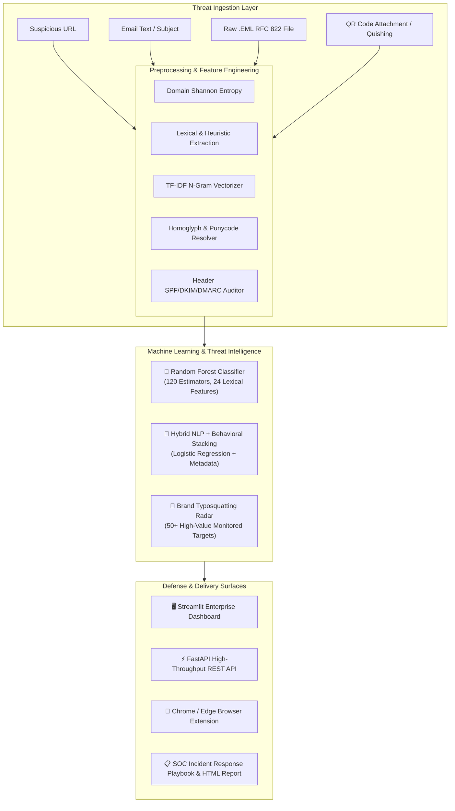

<div align="center">

# 🛡️ PhishGuard Enterprise AI

### Dual-Engine Phishing Defense & Cyber Threat Intelligence Platform

[](https://github.com/deepanshuRajput91134/ai-phishing-detector/actions)
[](https://www.python.org/)
[](https://opensource.org/licenses/MIT)
[](https://fastapi.tiangolo.com)
[](https://streamlit.io)
[](https://www.docker.com/)

An enterprise-grade, multi-layered cyber defense platform designed to analyze, score, and neutralize modern social engineering, brand typosquatting, email header spoofing, malicious hyperlinks, and QR-code phishing (Quishing) in real time.

</div>

---

## 🏛️ System Architecture



---

## 🌟 Key Defensive Innovations

### 1. 🎯 Brand Typosquatting & Homoglyph Radar
* **50+ Monitored Enterprise Targets:** Covers global banking (PayPal, Chase, Wells Fargo, Binance), Big Tech (Apple, Microsoft, Google, Netflix), logistics (DHL, FedEx, USPS), and government portals.
* **Homoglyph & Edit Distance Resolution:** Exposes deceptive visual substitutions such as `paypa1.com`, `rnicrosoft.com`, `g00gle.com`.
* **Combosquatting & Subdomain Traps:** Unmasks brand-keyword coupling (`paypal-security-alert.xyz`) and mobile address bar deception (`apple.com.secure-auth.top`).
* **IDN Punycode Detection:** Flags internationalized domain name attacks (`xn--...`).

### 2. 🧠 Explainable AI (XAI) Social Engineering Highlighter
Provides transparent, color-coded visual evidence of the exact psychological lures triggering the AI:
* 🔴 **Red:** Credential Harvesting Lures (*"verify your password"*, *"enter card PIN"*)
* 🟠 **Orange:** Psychological Urgency & Panic Triggers (*"account suspended within 24 hours"*)
* 🟡 **Yellow:** Financial & Prize Lures (*"wire transfer"*, *"tax refund"*, *"overdue invoice"*)
* 🟣 **Purple:** Impersonal Salutations (*"Dear Customer / Valued Member"*)
* 🔵 **Blue:** Embedded Target Hyperlinks

### 3. 📧 Raw RFC 822 (.EML) Header & Spoof Auditor
* **Domain Alignment Checks:** Verifies `From` vs `Reply-To` vs `Return-Path` to prevent identity spoofing.
* **Authentication Validation:** Parses SPF results, DKIM cryptographic signatures, and DMARC enforcement.
* **Attachment Armor:** Flags malicious executables and script payloads (`.exe`, `.scr`, `.iso`, `.hta`, `.vbs`, `.js`, `.xlsm`).

### 4. 📷 Quishing (QR Phishing) Defense Engine
* Scans uploaded images, invoices, and email screenshots for hidden QR barcodes.
* Automatically decodes the underlying URL and routes it through PhishGuard's lexical and brand-impersonation engine.

### 5. 📋 Automated Executive Incident Reports & SOC Playbooks
* Generates clean, branded **HTML Security Incident Reports** with CVSS-style severity grading.
* Outputs actionable, step-by-step remediation procedures for SOC analysts:
  * *Perimeter Containment:* Immediate DNS and SWG FQDN blocks.
  * *Identity Action:* Force session revocation and password resets.
  * *Mailbox Purge:* Administrative tenant-wide removal of identical envelope senders.

---

## 🚀 Quickstart Guide

### Option A: 🐳 Docker & Docker Compose (Recommended)

Run the entire ecosystem (Streamlit UI + FastAPI REST server) in one command:
```bash
docker compose up --build
```
* **Web Dashboard:** [http://localhost:8501](http://localhost:8501)
* **API Swagger Docs:** [http://localhost:8000/docs](http://localhost:8000/docs)

---

### Option B: 🐍 Local Python Virtual Environment

1. **Clone the repository:**
   ```bash
   git clone https://github.com/deepanshuRajput91134/ai-phishing-detector.git
   cd ai-phishing-detector
   ```

2. **Create and activate a virtual environment:**
   ```bash
   python3 -m venv venv
   source venv/bin/activate   # On Windows: venv\Scripts\activate
   ```

3. **Install dependencies:**
   ```bash
   pip install -r requirements.txt
   ```

4. **Launch the services:**
   * **Streamlit Web UI:**
     ```bash
     streamlit run app.py
     ```
   * **FastAPI Server (in a separate terminal):**
     ```bash
     uvicorn api:app --host 0.0.0.0 --port 8000 --reload
     ```

---

## 💻 Command Line Interface (CLI)

Perform lightning-fast scans directly from your terminal:

```bash
# Scan a suspicious URL for typosquatting and lexical anomalies
python cli.py --url "http://paypa1-security.xyz/login.php"

# Audit an exported raw email (.eml) file
python cli.py --email-file "sample.eml"

# Scan email text and subject directly
python cli.py \
  --subject "URGENT: Your account has been suspended" \
  --email-text "Dear Customer, Unauthorized charges detected. Verify your card immediately: http://192.168.1.50/bank/login.php"
```

---

## ⚡ REST API Endpoints

FastAPI provides an interactive OpenAPI / Swagger documentation at `http://localhost:8000/docs`:

| Method | Endpoint | Description |
| :--- | :--- | :--- |
| `POST` | `/api/scan-url` | Analyzes URLs for structural anomalies & brand impersonation |
| `POST` | `/api/scan-email` | Evaluates email text with NLP & outputs XAI highlighted HTML |
| `POST` | `/api/deep-scan` | Correlates email content with all extracted embedded links |
| `POST` | `/api/scan-eml` | Multipart upload for RFC 822 `.eml` header & attachment audit |
| `POST` | `/api/scan-qr` | Inspects QR code images for Quishing threat vectors |
| `POST` | `/api/export-report` | Generates a publication-ready Executive Incident Report (HTML) |
| `GET` | `/api/metrics` | Returns live classifier accuracy, precision, recall & F1 scores |

---

## 🧩 Browser Extension Setup (Chrome / Edge / Brave)

1. Open `chrome://extensions` in your browser.
2. Toggle on **Developer mode** (top-right corner).
3. Click **Load unpacked** and select the [`browser_extension`](browser_extension/) directory.
4. Click the **PhishGuard AI** shield icon in your toolbar to scan the active tab with 1 click!

---

## 🧪 Automated Testing

PhishGuard includes a complete suite of unit and integration tests powered by PyTest:

```bash
pytest tests/ -v
```

All 17 tests validate domain intelligence, homoglyph normalization, RFC 822 email parsing, ML inference, and Quishing decoders.

---

## 📁 Repository Structure

```text
ai-phishing-detector/
├── .github/workflows/ci.yml    # GitHub Actions Multi-Python CI Pipeline
├── app.py                      # Streamlit Enterprise Dashboard (7 Tabs)
├── api.py                      # FastAPI High-Throughput REST API
├── cli.py                      # Terminal Command-Line Scanner Tool
├── Dockerfile                  # Production Multi-Stage Container
├── docker-compose.yml          # Container Orchestration
├── requirements.txt            # Python Dependencies
├── LICENSE                     # MIT License
├── README.md                   # System Documentation
├── browser_extension/          # Manifest V3 Chrome Extension
│   ├── manifest.json
│   ├── popup.html
│   ├── popup.js
│   └── README.md
├── src/                        # Core AI & Threat Intel Modules
│   ├── domain_intel.py         # Brand Typosquatting & Homoglyph Radar
│   ├── eml_parser.py           # RFC 822 EML Header Spoof Auditor
│   ├── xai_highlighter.py      # Explainable AI (XAI) Visual Text Marker
│   ├── quishing.py             # QR Code Phishing Defense Module
│   ├── report_generator.py     # Executive Incident & SOC Playbook Generator
│   ├── features.py             # Feature Extraction (Entropy, RegEx, NLP)
│   ├── dataset_generator.py    # Dataset Synthesis & CSV Loader
│   ├── train.py                # Dual Model Training & Metrics
│   └── predictor.py            # Unified Inference Engine
├── tests/                      # PyTest Automated Unit Tests
│   ├── test_domain_intel.py
│   ├── test_features.py
│   ├── test_eml_parser.py
│   ├── test_predictor.py
│   └── test_quishing.py
├── data/                       # Datasets (3,000 URLs, 2,400 Emails)
└── models/                     # Trained Model Artifacts (.joblib)
```

---

## 📜 License

This project is licensed under the MIT License - see the [LICENSE](LICENSE) file for details.

Developed with ❤️ by **[Deepanshu Rajput](https://github.com/deepanshuRajput91134)**.
